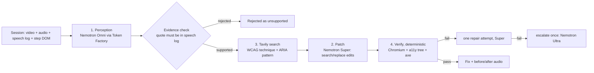

# Heard

**Linters read your code. Heard listens to your product.**

Heard audits web accessibility by *listening to a screen-reader session*, not just linting code. It takes a recording of a session (screen video, announcement audio, timestamped speech log), finds places where **what the user heard does not match what is on screen or what a user needs** (for example an icon-only button announced as just "button"), patches the source, cites the relevant WCAG criterion via live web search, and verifies the fix. It then reports how many issues axe-core alone would have caught versus how many Heard caught.

Built for the Nebius x NVIDIA Global AI Hackathon. MIT licensed.

> **Honest status (read this first).** This repository was assembled without Nebius Token Factory or Tavily credentials, so the live model path (perception, patch, escalation, Tavily) is implemented and unit-tested against scripted fakes but **has not yet been run against the real APIs**. The cached demo and benchmark currently use a clearly labeled **non-model "oracle stub"** so the UI, verifier and eval run without keys. The **axe-core numbers are real**; the **Heard numbers are placeholders until you run the live pipeline** (steps below). `PERCEPTION_MODE` is currently `text_only_log` (the default before the probe has run).

## How it works



1. **Perception** (`MODEL_PERCEPTION`, Nemotron Nano Omni): prompted as an accessibility auditor, returns strict JSON (pydantic schema, one retry). Input adapts to `PERCEPTION_MODE` from `data/capabilities.json`:
   - `native_av`: the session mp4 (and wav, if the probe found a working `input_audio` variant) go straight to the model.
   - `frames_plus_log`: ffmpeg samples a frame at each step timestamp and sends them with the speech-log text.
   - `text_only_log`: speech log plus per-step screen context, no pixels.
2. **Evidence check** (deterministic): a finding is dropped unless its `announced_text` appears in the speech log near `t_start` (or it claims silence where a silent action exists). The UI shows the "rejected as unsupported" count. This is a feature: it measures how often the model hallucinated.
3. **Citation** (Tavily, runtime): one search per finding by issue type and WCAG criterion; titles and URLs are stored as citations and the snippets ground the patch prompt. Every call is logged.
4. **Patch** (`MODEL_PATCH`, Nemotron Super): given the finding, the step's DOM context, the site source and the Tavily snippets, returns minimal `{file, old_str, new_str}` edits.
5. **Verify** (no LLM): edits are applied to a temp copy (failing cleanly unless `old_str` is unique), served locally, loaded in Chromium; an assertion generated from the finding type is checked through the CDP accessibility tree, and axe-core must report **no new violations**. On failure: one repair attempt with the failure reason, then one escalation to `MODEL_ESCALATION` (Nemotron Ultra). The model that fixed it is recorded.
6. **Cost tracker** wraps every model call (stage, model, tokens, latency, estimated cost from the `PRICE_PER_1M_*` variables).

## Which models and services, and why

| Role | Model (set in `.env`) | Why |
|---|---|---|
| Perception | Nemotron 3 Nano Omni (`MODEL_PERCEPTION`) | Multimodal (video/audio/image) is the point of the product; small and fast enough to run on every session. |
| Patch | Nemotron 3 Super (`MODEL_PATCH`) | Needs precise structured edits to source files; more capable than Nano. |
| Escalation | Nemotron 3 Ultra (`MODEL_ESCALATION`) | Used only when Super fails verification twice. |

- **Nebius Token Factory**: all three models are called at runtime through its OpenAI-compatible API (`backend/app/llm.py`, `NEBIUS_BASE_URL`). Model IDs are never hardcoded; run `scripts/probe_models.py` to list the live Nemotron IDs.
- **Tavily**: real runtime search in the main pipeline (`backend/app/pipeline/citation.py`).
- **Other Nebius services**: Nebius Serverless (container endpoint) is the documented hosting target; no other Nebius service is used.

## Quick start

Prerequisites: [uv](https://docs.astral.sh/uv/) (it installs Python 3.12 from `.python-version`), Node 20+, ffmpeg, a TTS (macOS `say`, or `espeak-ng` on Linux).

```bash
git clone <this repo> && cd Heard
make setup                      # uv sync + Playwright Chromium + npm install (frontend, scripts)
cp .env.example .env            # then fill in real values (never commit .env)
```

Python dependencies live in `pyproject.toml` / `uv.lock`; add one with `uv add <pkg>` (or `uv add --dev <pkg>`).

**No keys needed for the cached demo:**

```bash
make run          # builds the frontend and serves http://localhost:8000 (landing page; the demo is at /app/)
```

**With keys (real run), in this order:**

```bash
uv run scripts/probe_models.py        # M0: lists Nemotron IDs, tests text/image/video/audio, writes data/capabilities.json (PERCEPTION_MODE)
# put the printed IDs into MODEL_PERCEPTION / MODEL_PATCH / MODEL_ESCALATION and the prices from the Nebius console into .env
uv run scripts/precompute_cache.py    # live analysis of all demo sessions -> data/cache/
uv run eval/run_eval.py               # axe vs Heard -> eval/results.json, eval/RESULTS.md
make run                              # "Run live" is now enabled in the UI
```

Other commands: `uv run scripts/generate_sessions.py` (regenerate the simulated sessions), `uv run scripts/build_demo_sites.py` (regenerate the reference `fixed/` sites), `make test`.

## Demo sites and seeded bugs

Three small static sites (`demo_sites/{shop,signup,dashboard}/{buggy,fixed}`), 12 seeded bugs recorded in `data/bugs/*.json` (B01 to B12 as in the spec). Whether axe catches each bug is **measured, not asserted**. One instructive case: **B03** (input with a placeholder but no label) is *not* audible in the simulated session, because Chromium computes the accessible name from the placeholder, so the screen reader says "Email address, edit text". Heard can only detect it by reasoning about on-screen structure, which is exactly the kind of result the benchmark should show honestly.

## Sessions: simulated, and how to add a real one

Sessions in `data/sessions/*_buggy/` are **simulated screen reader** sessions: Playwright drives Tab/Enter/Space (plus a browse pass over headings and images), the announcement for each step is built as `"{accessible name}, {role}"` from the browser accessibility tree, spoken with TTS, and muxed with the screen capture. This is a model of a screen reader, not NVDA or VoiceOver.

To add a real recording (e.g. VoiceOver or NVDA), create `data/sessions/real_<name>/` with `session.mp4`, optional `audio.wav`, `speech_log.json` (`[{"t": seconds, "text": "..."}]`), `steps.json` (per-step `t, key, selector, html, name, role, announcement, visible_text`) and `meta.json` (`id, site, label, source_dir` pointing at the site folder to patch, e.g. `demo_sites/shop/buggy`). It then appears in the session picker and runs through the same pipeline. A drag-and-drop upload endpoint was cut for time (item 3 on the cut list).

## Results

Source: `eval/RESULTS.md` (regenerate with `uv run eval/run_eval.py`). Currently:

| Metric | Value |
|---|---|
| axe-core detected (real measurement) | **4/12** (B01, B02, B09, B12) |
| Heard detected | **placeholder** (oracle stub); live number pending |
| Fixes verified | placeholder (the 12 reference fixes all pass the verifier; 12 matching "no edit" controls all fail it) |
| Rejected as unsupported | 0 (stub; live number pending) |

axe-core misses 8 of 12: vague link text, repeated identical controls, missing/placeholder-only label, un-announced error, missing checkbox state, div-as-button, modal semantics and focus, and tab roles.

## Deployment

The Dockerfile builds the frontend, installs Chromium (Playwright base image), ffmpeg and espeak-ng, bakes `data/` (sessions + cached results) into the image, and runs uvicorn on `$PORT` (default 8000).

```bash
docker build -t heard .
docker run --rm -p 8000:8000 --env-file .env heard      # .env optional: without keys the cached demo still works
```

**Nebius Serverless** (flags from the current Nebius CLI docs: `nebius ai create --type endpoint` / `nebius ai endpoint create`; double-check with `--help`, as these may change):

```bash
# push the image to a registry reachable by Nebius, then:
nebius ai endpoint create \
  --name heard-demo \
  --image <registry>/heard:latest \
  --platform cpu-d3 --preset 4vcpu-16gb \
  --container-port 8000 \
  --auth none \
  --env NEBIUS_BASE_URL=https://api.tokenfactory.nebius.com/v1/ \
  --env MODEL_PERCEPTION=<id> --env MODEL_PATCH=<id> --env MODEL_ESCALATION=<id> \
  --env-secret NEBIUS_API_KEY=<mysterybox selector> --env-secret TAVILY_API_KEY=<mysterybox selector> \
  --subnet-id <subnet-id>
```

`--auth none` is the CLI default and is what makes the demo usable by judges without a login; do not use `--auth token` for the public demo. Use `--env-secret` (MysteryBox) for the API keys rather than plain `--env`. Add `--registry-username/--registry-password` (or `--registry-secret`) if the registry is private. I have not been able to run this deployment from the build environment, so treat the command as unverified until you try it.
**Generic fallback:** any container host (Fly.io, Render, Cloud Run, a VM with Docker): build the image, expose port 8000, set the same environment variables.

The public demo is protected by an **in-memory per-IP rate limit** on live analyses (`RATE_LIMIT_ANALYSES_PER_HOUR`, default 6), cached results are served instantly with no keys, and API keys are never sent to the browser.

## Limitations

- Sessions are **simulated**; a real VoiceOver/NVDA clip has not been run through it yet.
- Verification is a **deterministic accessibility-tree proxy** for screen-reader output, not a live screen reader. It can pass a fix a real screen reader would still announce awkwardly, and it only knows the assertions in `verify.py`.
- The live model path has not been exercised against the real APIs in this repo's history (see status above); `FEEDBACK.md` lists what to confirm.
- Only 12 seeded bugs on 3 tiny static sites; numbers say nothing about real-world sites.
- Browser `<video>` playback needs an H.264-capable browser (Chrome, Safari, Firefox desktop).

## License

MIT, see `LICENSE`.
