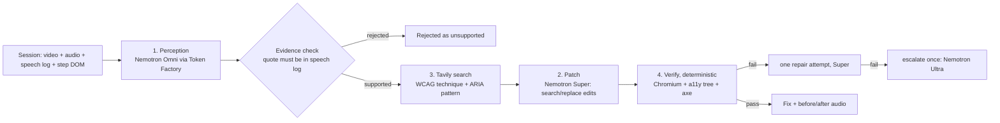

# Heard

**Linters read your code. Heard listens to your product.**

Heard audits web accessibility by *listening to a screen-reader session*, not just linting code. It takes a recording of a session (screen video, announcement audio, timestamped speech log), finds places where **what the user heard does not match what is on screen or what a user needs** (for example an icon-only button announced as just "button"), patches the source, cites the relevant WCAG criterion via live web search, and verifies the fix. It then reports how many issues axe-core alone would have caught versus how many Heard caught.

Built for the Nebius x NVIDIA Global AI Hackathon. MIT licensed.

> **Status.** The pipeline runs live: perception with Nemotron 3 Nano Omni on NVIDIA's API (it watches the session video and hears its soundtrack), patching and escalation with Nemotron Super and Ultra on Nebius Token Factory, and W3C-only Tavily citations. The cached demo and benchmark come from a live run on 2026-10-28 (`source: live`). Sessions are still simulated screen-reader sessions, and verification is an accessibility-tree proxy (see Limitations).

## How it works



1. **Perception** (`MODEL_PERCEPTION`, Nemotron 3 Nano Omni via NVIDIA's API): prompted as an accessibility auditor, returns strict JSON (pydantic schema, one retry). Input adapts to `PERCEPTION_MODE` from `data/capabilities.json`:
   - `native_av`: the session mp4 goes straight to the model, which **watches the screen and hears the screen reader's audio in the same input** (`use_audio_in_video`). The probe also supports a separate `audio_url` / `input_audio` clip.
   - `frames_plus_log`: ffmpeg samples a frame at each step timestamp and sends them with the speech-log text.
   - `text_only_log`: speech log plus per-step screen context, no pixels.
2. **Evidence check** (deterministic): a finding is dropped unless its `announced_text` appears in the speech log near `t_start` (or it claims silence where a silent action exists). The UI shows the "rejected as unsupported" count. This is a feature: it measures how often the model hallucinated.
3. **Citation** (Tavily, runtime): the WCAG criterion is fixed per issue type (`citation.CRITERION`), not taken from the model's guess. Each search is limited to `w3.org` (`include_domains`, with a host check as a backstop), so every citation is a W3C Understanding, Technique or ARIA Authoring Practices page. Titles and URLs become citations, and the snippets ground the patch prompt. Non-empty results are cached per query for 30 days (in memory, and in `.heard/tavily-cache.json` for `heard fix`); an empty answer is never cached, so it is retried. Every live call is logged.
4. **Patch** (`MODEL_PATCH`, Nemotron Super): given the finding, the step's DOM context, the site source and the Tavily snippets, returns minimal `{file, old_str, new_str}` edits.
5. **Verify** (no LLM): edits are applied to a temp copy (failing cleanly unless `old_str` is unique), served locally, loaded in Chromium; an assertion generated from the finding type is checked through the CDP accessibility tree, and axe-core must report **no new violations**. On failure: one repair attempt with the failure reason, then one escalation to `MODEL_ESCALATION` (Nemotron Ultra). The model that fixed it is recorded.
6. **Cost tracker** wraps every model call (stage, model, tokens, latency, estimated cost from the `PRICE_PER_1M_*` variables).

## Which models and services, and why

| Role | Model (set in `.env`) | Why |
|---|---|---|
| Perception | Nemotron 3 Nano Omni (`MODEL_PERCEPTION`, `PERCEPTION_PROVIDER=nvidia`) | Sees video and hears its soundtrack in one input, which is the point of the product. Runs on NVIDIA's API because Token Factory's chat API accepts text, image and video content only (verified: `input_audio` and `audio_url` are rejected with 422 for every model). |
| Patch | Nemotron 3 Super (`MODEL_PATCH`) | Needs precise structured edits to source files; more capable than Nano. |
| Escalation | Nemotron 3 Ultra (`MODEL_ESCALATION`) | Used only when Super fails verification twice. |

- **Nebius Token Factory**: patching (Nemotron Super) and escalation (Nemotron Ultra) run on its OpenAI-compatible API (`heard/app/llm.py`, `NEBIUS_BASE_URL`). Each role picks its provider with `{ROLE}_PROVIDER` (`nebius` by default, or `nvidia`).
- **NVIDIA API** (`integrate.api.nvidia.com`, `NVIDIA_API_KEY`): perception with Nemotron 3 Nano Omni, for audio. Busy responses (429/503, common on the shared endpoint) are retried with backoff. Model IDs are never hardcoded; `scripts/probe_models.py` lists them and checks that the perception model really understands image, video and audio (a correct answer is required, not just HTTP 200).
- **Tavily**: real runtime search in the main pipeline (`heard/app/pipeline/citation.py`).
- **Other Nebius services**: Nebius Serverless (container endpoint) is the documented hosting target; no other Nebius service is used.

## Quick start

Prerequisites: [uv](https://docs.astral.sh/uv/) (it installs Python 3.12 from `.python-version`), Node 20+, ffmpeg, a TTS (macOS `say`, or `espeak-ng` on Linux).

```bash
git clone <this repo> && cd Heard
make setup                      # uv sync + Playwright Chromium + npm install (frontend, scripts)
cp .env.example .env            # then fill in real values (never commit .env)
```

Python dependencies live in `pyproject.toml` / `uv.lock`; add one with `uv add <pkg>` (or `uv add --dev <pkg>`).

**No keys needed for the cached demo:**

```bash
make run          # builds the frontend and serves http://localhost:8000 (landing page; the demo is at /app/)
```

**With keys (real run), in this order:**

```bash
uv run scripts/probe_models.py        # M0: lists Nemotron IDs, tests text/image/video/audio, writes data/capabilities.json (PERCEPTION_MODE)
# put the printed IDs into MODEL_PERCEPTION / MODEL_PATCH / MODEL_ESCALATION and the prices from the Nebius console into .env
uv run scripts/precompute_cache.py    # live analysis of all demo sessions -> data/cache/
uv run eval/run_eval.py               # axe vs Heard -> eval/results.json, eval/RESULTS.md
make run                              # "Run live" is now enabled in the UI
```

Other commands: `uv run scripts/generate_sessions.py` (regenerate the simulated sessions), `uv run scripts/build_demo_sites.py` (regenerate the reference `fixed/` sites), `make test`.

## Heard on every push (CLI)

`heard` checks any running web app for accessibility regressions. The target repo needs nothing installed: the browser already builds an accessibility tree for every page.

Install: `npx heard <command>` (Node ≥18 plus [uv](https://docs.astral.sh/uv/)) or `uvx heard <command>` (uv only). The npm package is a thin launcher for the Python CLI of the same version. Chromium is downloaded on first run. Unreleased `main`: `HEARD_FROM=git+https://github.com/WinexWolf/Heard npx heard …` or `uvx --from git+https://github.com/WinexWolf/Heard heard …`.

```bash
npx heard init      # writes heard.toml: url, optional start command, pages, flows
npx heard snapshot  # records what a screen-reader user hears -> heard.snapshot.json (commit it)
npx heard check     # re-records, diffs, audits only what changed; exit 1 on regressions
npx heard report    # opens the last check as a page (.heard/report.html)
npx heard fix       # patches your source for those regressions; keeps only fixes verified on the running app
```

How `check` keeps model cost down while still running on every push:

1. **Record (no model):** Heard drives each page in Chromium like a screen-reader user: a browse pass over headings and images, then Tab through every focusable element. It never clicks on its own; Enter, Space and typing happen only in `flows` you declare. Each step's announcement is built from the accessibility tree. This takes a few seconds per page.
2. **Diff:** the new speech is compared with the baseline snapshot from the base commit (`--base`, default: the PR's target branch in CI, else `HEAD`). A change anywhere in the code that alters what users hear shows up, even on pages the change didn't touch. Selector or markup changes that sound the same are ignored.
3. **Audit only the diff:** changed steps, with two steps of context on each side, go to `MODEL_PERCEPTION`. The same evidence check drops findings whose quote was never heard. Identical diffs are answered from `.heard/cache.json`, keyed by the diff, the model ID and a hash of the system prompt, so switching models or editing the prompt re-audits. Entries expire after 30 days. A push that changes nothing users hear makes zero model calls.
4. **Decide:** the check exits 1 on new issues at or above `fail_on`. It writes `.heard/report.md` (also to the GitHub step summary), `.heard/report.json` and `.heard/report.html`. Without a model key, it still reports the speech diff and exits 0 as "unaudited".

`.heard/report.html` is one self-contained page (no server, no network) with the result, each regression, and a before/after of every announcement that changed, in light or dark. It opens straight from a downloaded CI artifact. It is built from `frontend/src/Report.tsx` into `heard/app/report_ui/report.html`, which is committed so `uvx` installs have it. `npm run build` regenerates it.

`examples/github-action.yml` runs this on every push and PR, comments the report on PRs, and uploads `.heard/`. Because the snapshot is committed, a PR's diff of `heard.snapshot.json` shows reviewers exactly what screen-reader users will hear differently.

Measured on the demo sites, with the shop and signup served as one app and a fixed → buggy "push": the diff surfaced the unlabeled cart button, missing alt text, the three "Learn more" links, five identical "Edit" buttons, the checkbox that lost its state, "Continue" instead of "Create account", and the validation error that went silent. It took about 5 s with no model calls (`heard/tests/test_cli.py`). The placeholder-only email field (B03) sounds the same either way, so the diff can't hear it.

`heard fix` works on the last check's failing findings (`--all` for every finding), against your running dev server:

1. **Already fixed?** The live page is checked first. If it already passes, the finding is skipped and no model call is made.
2. **Locate:** the element's id, `aria-label`, alt, placeholder, classes and visible text from the snapshot are searched for under `src` in `heard.toml`. The best-matching files (at most 3, skipping `node_modules`, build output and files over 60 KB) are sent to `MODEL_PATCH`, plus Tavily snippets if `TAVILY_API_KEY` is set.
3. **Patch and verify live:** the edits are written to your working tree. Once the dev server reloads, the page must pass the assertion for that issue type (accessible name, label, live region, dialog focus, tab state, and so on) with no new axe violations. Heard polls for up to `fix_timeout` seconds (default 10).
4. **Repair, escalate, restore:** a failed attempt is restored byte for byte, then retried once with the failure reason, then once with `MODEL_ESCALATION`. Only verified fixes stay in your tree. `--dry-run` verifies them and then reverts too. Diffs are written to `.heard/fixes/`, and the report shows each fix's status, the model that made it, what users now hear, and the diff.

Then review with `git diff` and accept the new speech with `heard check --update`. Known limits: the locator matches text, so a component whose markup is assembled from props may not be found (reported as "source not found"); and a fix that changes the element's selector (for example a `div` path selector after turning it into a `button`) fails verification unless the element keeps its id.

### Releasing the CLI

PyPI first: the npm launcher runs `uvx heard==<its own version>`, so that version must already exist on PyPI. Keep `pyproject.toml` and `npm/package.json` at the same version (a test enforces it).

```bash
(cd frontend && npm run build)      # refreshes heard/app/report_ui/report.html, which ships in the wheel
uv build && uv publish              # PyPI: needs a PyPI token (UV_PUBLISH_TOKEN)
(cd npm && npm publish)             # npm: needs `npm login`
```

## Demo sites and seeded bugs

Three small static sites (`demo_sites/{shop,signup,dashboard}/{buggy,fixed}`), 12 seeded bugs recorded in `data/bugs/*.json` (B01 to B12 as in the spec). Whether axe catches each bug is **measured, not asserted**. One instructive case: **B03** (input with a placeholder but no label) is *not* audible in the simulated session, because Chromium computes the accessible name from the placeholder, so the screen reader says "Email address, edit text". Heard can only detect it by reasoning about on-screen structure, which is exactly the kind of result the benchmark should show honestly.

## Sessions: simulated, and how to add a real one

Sessions in `data/sessions/*_buggy/` are **simulated screen reader** sessions: Playwright drives Tab/Enter/Space (plus a browse pass over headings and images), the announcement for each step is built as `"{accessible name}, {role}"` from the browser accessibility tree, spoken with TTS, and muxed with the screen capture. This is a model of a screen reader, not NVDA or VoiceOver.

To add a real recording (e.g. VoiceOver or NVDA), create `data/sessions/real_<name>/` with `session.mp4`, optional `audio.wav`, `speech_log.json` (`[{"t": seconds, "text": "..."}]`), `steps.json` (per-step `t, key, selector, html, name, role, announcement, visible_text`) and `meta.json` (`id, site, label, source_dir` pointing at the site folder to patch, e.g. `demo_sites/shop/buggy`). It then appears in the session picker and runs through the same pipeline. A drag-and-drop upload endpoint was cut for time (item 3 on the cut list).

## Results

Source: `eval/RESULTS.md` (regenerate with `uv run scripts/precompute_cache.py && uv run eval/run_eval.py`). One live run of all three sessions on 2026-10-28:

| Metric | Value |
|---|---|
| axe-core detected | **4/12** (B01, B02, B09, B12) |
| Heard detected | **10/12** |
| Fixes verified | **10/10** (a fix counts only if it targets the bug's own category and passes verification) |
| Rejected as unsupported | 0 |
| Model calls / cost / time | 17 calls · **$0.0195** · 268 s for all three sessions (about a minute of perception per session) |

- **Where Heard beats axe-core:** vague links, repeated identical controls, the unannounced error, the checkbox with no state, the div acting as a button and the modal without dialog semantics. axe-core flags none of these.
- **Missed:** B03 (placeholder-only email label) is inaudible, because Chromium names the field from its placeholder, so it sounds the same broken or fixed. B08 (tab roles) was not reported by perception in this run.
- **Run-to-run variation:** detection varies slightly between live runs even at temperature 0. Across the last five runs, B04, B07 and B08 were each missed once.
- **Escalation earns its place:** in this run, Nemotron Ultra fixed the modal and the missing alt text after Nemotron Super failed verification twice on each.
- **Guards behind these numbers:**
  - The evidence check drops quotes that were never heard.
  - Duplicate findings for one widget are merged.
  - A finding whose issue type can't apply to its element is corrected (e.g. `vague_link` on a button becomes `label_in_name`).
  - A finding the unpatched page already passes is rejected as not reproduced, so it can never count as a fix.

## Deployment

The Dockerfile builds the frontend, installs Chromium (Playwright base image), ffmpeg and espeak-ng, bakes `data/` (sessions + cached results) into the image, and runs uvicorn on `$PORT` (default 8000).

```bash
docker build -t heard .
docker run --rm -p 8000:8000 --env-file .env heard      # .env optional: without keys the cached demo still works
```

**Render** (what the public demo uses): `render.yaml` is a Blueprint. In the Render dashboard choose **New → Blueprint**, pick this repo, and paste the three secret keys (`NEBIUS_API_KEY`, `NVIDIA_API_KEY`, `TAVILY_API_KEY`) when asked. The model IDs, providers, thinking budget and prices are already set in the file. Pushes to `main` redeploy automatically.

- **Sizing (measured):** the cached demo idles at about 110 MiB. A live run's verification peaks at about 400 MiB (three Chromium verifications at 512 MiB, natively), so the **Starter** plan (512 MB) works. Verifications are serialized server-wide (`VERIFY_CONCURRENCY`, default 1), so two visitors pressing "Run live" at once queue instead of running out of memory.
- **Proxy:** uvicorn runs with `--proxy-headers`, so the per-visitor rate limit sees each visitor's real IP behind Render's proxy.
- **Image:** about 2 GB (mostly Chromium), so the first build takes a few minutes.

**Nebius Serverless** (flags from the current Nebius CLI docs: `nebius ai create --type endpoint` / `nebius ai endpoint create`; double-check with `--help`, as these may change):

```bash
# push the image to a registry reachable by Nebius, then:
nebius ai endpoint create \
  --name heard-demo \
  --image <registry>/heard:latest \
  --platform cpu-d3 --preset 4vcpu-16gb \
  --container-port 8000 \
  --auth none \
  --env NEBIUS_BASE_URL=https://api.tokenfactory.nebius.com/v1/ \
  --env MODEL_PERCEPTION=<id> --env MODEL_PATCH=<id> --env MODEL_ESCALATION=<id> \
  --env-secret NEBIUS_API_KEY=<mysterybox selector> --env-secret TAVILY_API_KEY=<mysterybox selector> \
  --subnet-id <subnet-id>
```

`--auth none` is the CLI default and is what makes the demo usable by judges without a login; do not use `--auth token` for the public demo. Use `--env-secret` (MysteryBox) for the API keys rather than plain `--env`. Add `--registry-username/--registry-password` (or `--registry-secret`) if the registry is private. I have not been able to run this deployment from the build environment, so treat the command as unverified until you try it.
**Generic fallback:** any container host (Fly.io, Render, Cloud Run, a VM with Docker): build the image, expose port 8000, set the same environment variables.

The public demo is protected by an **in-memory per-IP rate limit** on live analyses (`RATE_LIMIT_ANALYSES_PER_HOUR`, default 6), cached results are served instantly with no keys, and API keys are never sent to the browser.

## Limitations

- Sessions are **simulated**; a real VoiceOver/NVDA clip has not been run through it yet.
- Verification is a **deterministic accessibility-tree proxy** for screen-reader output, not a live screen reader. It can pass a fix a real screen reader would still announce awkwardly, and it only knows the assertions in `verify.py`.
- Live results come from one run of three small demo sites. Perception varies slightly between runs (see Results), and the shared NVIDIA endpoint can be busy: Heard retries 429/5xx and timeouts with backoff, but a run can still fail and keep the previous cache.
- Token Factory's chat API does not accept audio (text, image and video only), so audio perception needs an NVIDIA API key.
- Only 12 seeded bugs on 3 tiny static sites; numbers say nothing about real-world sites.
- Browser `<video>` playback needs an H.264-capable browser (Chrome, Safari, Firefox desktop).

## License

MIT, see `LICENSE`.
